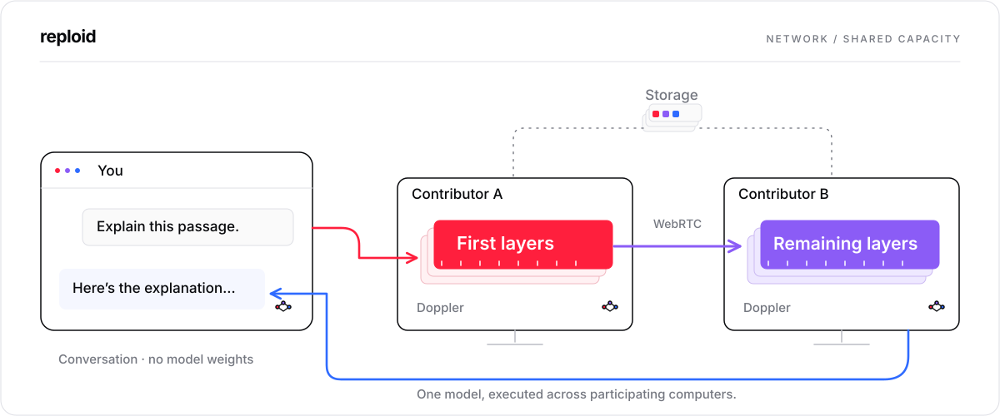

# Reploid

Run an open model on a participating computer, or contribute your own compute and storage, from a browser, CLI, or OpenAI- and Anthropic-compatible HTTP API without downloading model weights on the requesting machine. Today, using open models usually means choosing between a centralized cloud API with opaque routing or downloading gigabytes of weights onto one machine large enough to hold the whole model alone.

Reploid turns participating computers into shared inference capacity. The [public route table](docs/product-specification.md#5-contribution-and-execution) distinguishes local solo, remote solo, local + peer split, and remote-only split. A physically checked remote-solo route lets the requester ask without downloading weights. The two split routes are not yet qualified for public use. Serving computers can read the input they execute. [Quick start](docs/QUICK-START.md) · [Who can read what](docs/wire-visibility.md)

**[Try Reploid](https://replo.id/)** · [CLI and local setup](#try-it) · [Contribute a computer](docs/native-participant.md) · [Verified evidence](#what-is-verified)

[Play Reploid Daily](https://reploid-daily.reploid.workers.dev/) — get the model to say today's target in five tries, then dare a friend to beat your word count.

<picture>
  <source media="(max-width: 640px)" srcset="docs/diagrams/readme-architecture-mobile.svg">
  
</picture>

## Try it

### Browser (zero weight downloads)

1. Open [replo.id](https://replo.id/) and pick a shared model with a ready computer.
2. Check where the request will run before sending. The serving computer can read the input it executes. The qualification below tested reconnect to the same verified identity and fresh consent for a replacement.
3. Watch the answer stream. You can stop a response. The [claim index](docs/status/surface-claim-index.json) and [fleet service](docs/fleet-service.md) distinguish cancellation, interruptions, and settlement evidence.

### Command line (`npx reploid`)

Inspect available models, ask a ready peer directly without downloading weights, or serve a model from your own GPU:

```sh
npx reploid models
npx reploid ask "Explain speculative decoding in two sentences."
npx reploid ask 35b "The same, from a named model."
npx reploid serve
```

Without a model, `ask` uses the smallest model a ready provider serves and says which, and `serve` serves
the 0.8B, the smallest catalog model. Name a model (`npx reploid serve 2b --model-directory /path/to/weights`)
for any other.

### Local workspace and HTTP API

From a repository checkout:

```sh
npm install
npm start
```

Open [http://localhost:8000](http://localhost:8000), or expose `/v1/chat/completions`, `/v1/responses`, and `/v1/messages` over an enrolled fleet requester (`server/fleet/text-api.js`). Running a model locally in your own browser requires WebGPU and local model files; requesting from a prepared peer requires only a connection to that peer. See the [testing guide](docs/TESTING.md) for verification checks.

## What is verified

- **0.1.5 candidate qualification (`reploid@0.1.5` + `dopplerx@0.1.5`)**: Signed `/v1/chat/completions` and `/v1/responses` execution with `34`-token prefix-cache reuse, mid-stream cancellation (`0` unacknowledged tokens charged, `0` open holds), fresh Chromium conversation with `0` weight bytes downloaded, returning-provider cryptographic reconnect + replacement-machine consent gate, `8.04x` two-supplier verified WebRTC piece transfer (`57.07 MB/s`), and zero-downtime backend rollback checks. [0.1.5 qualification receipts](reports/release-015-qualification/README.md)
- **Surface-by-surface claim ledger**: Use the [public claim index](docs/status/surface-claim-index.json) and [hash-verified historical evidence catalog](docs/evidence-catalog/README.md) as the canonical evidence entry points.

## Components

| I want to… | Start here |
| --- | --- |
| Work on chat, contribution, or the network view | [Product UI](apps/poolday), called Poolday internally |
| Preview or host the daily reverse-prompt game | [Daily game and circle setup](docs/daily-game.md) |
| Embed conversations or coordinate peers | [Reploid library](packages/reploid/src) |
| Load or execute a model | [Doppler](https://github.com/clocksmith/doppler) and [Reploid's runtime pin](shared/config/doppler-package.json) |
| Serve models or supply verified files from a desktop | [Native participant guide](docs/native-participant.md) |
| Run hosting, service APIs, or accounting | [Server](server) and [product contract](docs/product-specification.md) |
| Explore the separate Zero and X agent workspaces | [Setup and routes](docs/zero-x-quick-start.md) |

### Component ownership

Reploid handles discovery, permissions, placement, verified piece custody, and accounting. Doppler executes the model on each participating GPU. The [technical architecture diagram](docs/open-mesh-architecture.md#component-ownership) follows a request across several stages.

## How a model is stored and split

A **piece** is a hash-verified portion of a model file. A machine can store and supply pieces without executing requests, and receivers pull verified pieces concurrently across multiple suppliers with bounded slot backpressure. A **stage** runs a contiguous range of model layers. On a split route, each stage keeps its own model state and forwards activations; the final stage samples the token that streams back to the requester.

One recorded three-stage route ran layers 0–7 in a browser and layers 8–23 in two native stages on a second machine, averaging about 1.05 seconds per token on a quiet link. [Placement measurements](https://github.com/clocksmith/reploid/blob/e543183bed54dfdf2b6e6139dd4c31c8686f47bd/artifacts/placement-c-envelope-20261015/README.md) · [Precision measurements](https://github.com/clocksmith/reploid/blob/e543183bed54dfdf2b6e6139dd4c31c8686f47bd/artifacts/precision-recovery-20261015/README.md)

## Lifecycle of one request

A contributor advertises a prepared model or stage. Reploid selects an eligible route, reserves capacity, and binds permission to that attempt's cryptographic recipients. A retry gets a new attempt and a new admission check. Completed, cancelled, and interrupted attempts keep their own work records. [Request flow and receipts](docs/glossary.md#2-one-request) · [Security and trust](docs/SECURITY.md)

## Credits and accounting

Configured fleet services can quote a request and reserve non-cash service credits. This ordinary exchange is executor-readable: the serving computer can read the request and its answer, the recipients are shown before anything is sent, and it is not confidential pooling. Settlement is bound to accepted terms and verified evidence, with distinct rules for completed, cancelled, and interrupted work. An independent trade means a second human operator on their own machine with their own key and an outside verifier who is a different person; two local accounts under one operator do not count. A tested cancellation does not establish that every interruption route settles. Public token sales, cash payouts, and open marketplace settlement are not established features. [Product contract](docs/product-specification.md) · [Fleet service](docs/fleet-service.md) · [Goals](GOALS.md)

## Read next

[Documentation](docs/INDEX.md) · [Governance](GOVERNANCE.md) · [Hash-verified historical evidence](docs/evidence-catalog/README.md) · [Goals](GOALS.md) · [Contributing](AGENTS.md)

## License

[MIT](LICENSE).
