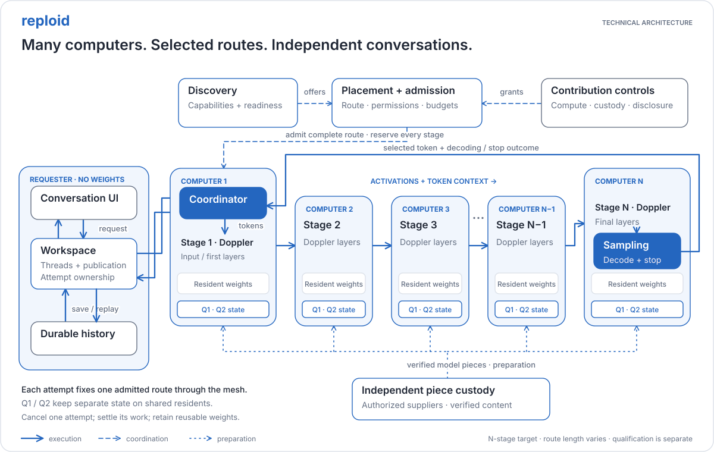

# Reploid

Reploid answers questions with open models that run on the requester's device, on another
participant's computer, or split by layers across several participants' computers. Model
computation is done by [Doppler](https://github.com/clocksmith/doppler), a WebGPU inference
library; Reploid does discovery, placement, admission, permissions, transport, conversation
history and accounting. The same repository also hosts two agent workspaces, Zero and X.

**Status:** early and not production. Conversations run today on a small engineering model
(Qwen 3.5 0.8B) through test-signed packages on a few machines. Credits, Community Access and
cited web search exist in source and are tested locally only. Per-surface status is in the
[claim index](docs/status/surface-claim-index.json).

[Try it](https://replo.id/) · [Quick start](docs/QUICK-START.md) · [Documentation](docs/INDEX.md) · [Product contract](docs/product-specification.md)

## Components

| Component | What it is | Where |
| --- | --- | --- |
| **Reploid library** | Conversations, discovery, placement, admission, partition coordination, transport, piece custody, retrieval, accounting clients | [`packages/reploid/src/`](packages/reploid/src) (`chat/`, `mesh/partitions/`, `transport/`, `artifacts/custody/`, `retrieval/`, `measurement/`) |
| **Poolday** | The network application and peer layer built on the library: the browser app at `/` (conversations, contribution settings, network inspector), rooms, signaling, WebRTC data channels, relays and authorized piece transfer | [`self/pool/`](self/pool), [`self/ui/pool-home/`](self/ui/pool-home), [`self/host/`](self/host) |
| **Doppler** | Separate repository. Loads signed model packages (Capsules), opens whole models or layer ranges as residents, runs WebGPU kernels, samples tokens | [clocksmith/doppler](https://github.com/clocksmith/doppler), pinned in [`self/config/doppler-package.json`](self/config/doppler-package.json) |
| **Native participant** | Node host that contributes storage and computation from a desktop GPU (Linux/Vulkan is the qualified path) | [`server/native-participant.js`](server/native-participant.js), [guide](docs/native-participant.md) |
| **Server** | `npm start` serves the app, proxies cloud model APIs for Zero/X, and optionally mounts search and earning routes | [`server/proxy.js`](server/proxy.js), [`server/`](server) |
| **Zero and X** | Agent workspaces at `/zero` and `/x` on a separate agent/VFS substrate (below) | [`self/core/`](self/core), [`self/tools/`](self/tools), [`self/ui/zero/`](self/ui/zero) |

Reploid coordinates, Doppler computes, Poolday carries the bytes. Reploid never implements
model mathematics; Doppler never decides who may run what.

### Component ownership



The diagram shows the general N-stage design with five computers; the measured route below has
three stages. It does not by itself establish package, route, concurrency or deployment
qualification.

## How a model is stored and split

A model is a signed Doppler **Capsule**: a manifest, the kernels it is allowed to run, and its
weights as content-addressed **pieces**.

- **Storage (pieces).** Custody acquires the pieces a participant is assigned from authorized
  suppliers, verifies each against its pinned hash, and keeps it in OPFS (browser) or on disk
  (native). Holding pieces is storage contribution; it is not execution.
- **Execution placements.** One conversation turn runs in one of three ways:
  - **local:** the whole model on the requester's device (needs WebGPU and the pieces);
  - **whole model on one peer:** a contributor that holds the complete model runs the request;
  - **ordered partition route:** the model's layers are split into contiguous ranges, one per
    stage, on different contributors. Each stage holds only its own range's pieces.

A measured three-stage route on two physical machines (placement C):

| Stage | Host | Layers |
| --- | --- | --- |
| 0 (coordinator) | browser on mac-host | embeddings, layers 0–7 |
| 1 | native on amd-host | layers 8–15 |
| 2 | native on amd-host | layers 16–23, final norm, LM head, sampling |

Per token, stage 0 tokenizes (first step only) and runs its layers, then sends the hidden-state
activations forward over a data channel. Each stage runs its layers and forwards the result;
the last stage samples and decodes the token, which returns to the coordinator and streams to
the requester. Every stage keeps its own KV cache and recurrent state for each attempt. A
prepared stage (a **resident**) can serve several attempts at once, each with separate state,
up to its admitted slots.

**Numerics.** Every package must match a frozen F64 reference within `0.001` on all 55 reference
prefixes. Today the kernels meet that only with a compensated two-F32 ("paired") arithmetic
profile. On one AMD GPU with no network, the current paired kernels decode at about 282 ms per
token against about 28 ms for ordinary F32, which fails the check. The cheapest passing mixed
configuration measured so far (paired layers 0–19, ordinary layers 20–23 and the output head)
decodes at about 205 ms per token and is not yet packaged
([precision evidence](artifacts/precision-recovery-20261015/README.md)). Recovering ordinary
speed under the same tolerance is open work. On a quiet link
the route above averages about 1.05 s per token; the
[measured breakdown](artifacts/placement-c-envelope-20261015/README.md) attributes each part
(GPU execution in the paired profile, network transfer, authorization, history writes).

## Lifecycle of one request

1. **Discovery.** Contributors advertise prepared residents: model identity, plan, layer range,
   free slots and queue room.
2. **Permission.** The first request that would leave the device asks once for permission to
   use remote contributors; it is revocable and recorded with the exact wording shown. A
   search-backed answer also asks per answer, naming the search service (or the person's own
   search server) and the contributors who will receive retrieved passages.
3. **Placement.** The requester chooses among complete, compatible, prepared routes. An opt-in
   coordinator ranking orders them by expected cost (latency, queueing, transfer, route
   opening, refusal and failure history, reserve); peer id only breaks ties. An attempt's route
   never changes once dispatched.
4. **Admission.** Each stage reserves a slot. If the route is full, the attempt waits in a
   bounded first-come queue at the coordinator (total and per-requester limits, a maximum
   wait) and shows as queued; nothing is sent to other stages until admission. Requests outside
   the route's declared prompt × answer × concurrency envelope are refused explicitly.
5. **Grants.** The coordinator issues signed, per-attempt grants bound to the route, model and
   expiry. Each stage verifies a grant once per attempt and rechecks binding, expiry and
   revocation on every step.
6. **Execution.** Steps pipeline under receiver credit (four one-way crossings per token on a
   three-stage route). Every stage call is bounded; the answer deadline ends an attempt with one
   explicit timeout.
7. **Evidence.** Stages sign cumulative receipts of the work done; the requester signs an
   acknowledgment for each output it received. For charged attempts, stages stop if more than
   two outputs go unacknowledged.
8. **Settlement.** Reservations release on completion, failure or cancellation. Retry always
   starts a new attempt; the history keeps the partial answer. Lost contributors and unknown
   remote cleanup are recorded as such, not assumed.

Each finished answer records its supply (local, mesh, hosted or mixed) and, for search,
whether retrieval ran on Reploid's server or on the device. No conversation is answered by a
hosted model; the code refuses an unrecognized or hosted executor.

## Credits and accounting (source only)

The [product contract](docs/product-specification.md) defines nonexpiring credits, funded
Community Access, quotes that bind model, disclosure, quality policy, deadline and spending
limit, and settlement with one economic effect per billable event. The ledger, rewards,
Community Access queue, receipts-based settlement, Supabase sign-in, Stripe Checkout and a
scheduler exist under [`server/`](server) and have run end to end only in a
[local demonstration](artifacts/earning-ui-demo-20261015/README.md) with test providers and a
fixture model.

## Zero and X

Zero and X run on a separate agent/VFS substrate, not the conversation path above. Files live in
an IndexedDB virtual file system; a Genesis snapshot allows rollback; inference uses a
cloud model through the server proxy, a direct API key, or local Doppler.

- **Zero** (`/zero`) is a minimal research agent. It starts with exactly one tool, `CreateTool`.
  Each cycle the model can write a new tool; activation runs the tool's declared fixtures,
  re-imports it in a fresh harness and replays them before installing. A created `self:write`
  tool can patch live tools, UI or mirrored core code with rollback evidence. The operator sets
  an objective and cycle interval and sees model input/output, tool runs, state and failures.
  [Journeys and status](docs/zero/critical-user-journeys.md).
- **X** (`/x`) is a governed superset of Zero with prebuilt file, promotion, optimization,
  cognition, worker and swarm tools. Changes are adopted only after independent evaluation
  under explicit, reversible operator grants; a model's own judgment never grants permission.
  [Journeys and status](docs/x/critical-user-journeys.md).

Setup for both: [Zero/X substrate and provider setup](docs/zero-x-quick-start.md).

## Run it

```sh
npm install
npm start          # server/proxy.js on http://localhost:8000
```

- `/` is the Poolday app (conversations, contribution, network); `/zero` and `/x` are the agent
  workspaces.
- Local execution needs a WebGPU browser and model files; using a prepared peer needs neither.
- Contribute from a desktop GPU with the native participant; flags, owner limits and readiness
  logging are in [docs/native-participant.md](docs/native-participant.md).
- Tests: `npx vitest run --config tests/vitest.config.js <file>`; see [docs/TESTING.md](docs/TESTING.md).

## Read next

- [Architecture](docs/open-mesh-architecture.md): component ownership, preparation, recovery.
- [Product contract](docs/product-specification.md): the public terms quotes and receipts bind.
- [Security](docs/SECURITY.md): permission and trust boundaries; signatures and receipts do not
  prove honest or confidential execution.
- [Goals](GOALS.md) · [Contributing](AGENTS.md).

## License

[MIT](LICENSE).
