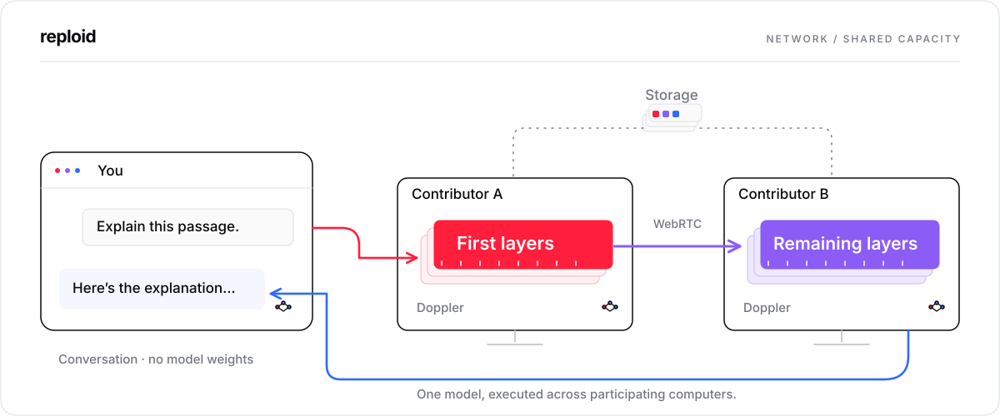

# Reploid

**Earn on your computer. Use AI anywhere.**

Reploid is an answer service. Ask questions, compare options, and get cited answers
from open models and web sources, with follow-ups and persistent history. Use it
through funded Community Access, a top-up, or credits your own computer earns by
contributing validated computation, storage or delivery within limits you set. Reploid coordinates
the network; [Doppler](https://github.com/clocksmith/doppler) runs the models.

Status: early. Conversations run on prepared contributors today; credits, Community
Access and cited search exist in source and are tested locally, not yet in production.

**[Try Reploid](https://replo.id/)** · [Get started](docs/QUICK-START.md) · [Documentation](docs/INDEX.md)

<picture>
  <source media="(max-width: 640px)" srcset="docs/diagrams/readme-architecture-mobile.svg" />
  
</picture>

## Get started

From a repository checkout, install and start the browser application:

```sh
npm install
npm start
```

Open `http://localhost:8000`. Choose an available model, ask a question, and review
recipients before sharing inputs. A prepared peer can execute without requester
weight downloads. Local execution separately requires WebGPU and model files.

Conversations remain independent. After interruption, keep the partial answer
and explicitly retry. Storage and compute contribution are optional, with their
own permissions and limits. See the [conversation contract](docs/chat-mvp.md).

## Technical architecture

### Component ownership


The technical view shows the intended N-stage architecture, with five computers
illustrating a variable-length route. Discovery supplies candidates; placement
and admission select a compatible route within grants and capacity. The route
stays fixed for its attempt. Independent custody supplies verified pieces.
The first contributor coordinates ordered steps; activations and token context
travel forward, and the final contributor samples and decodes. Selected tokens
return to the coordinator; identified output returns to the conversation owner.
Computers can contribute to multiple admitted questions, with separate attempt
state and reusable resident weights. Cancellation settles an attempt without
implying that its computer stops contributing. Storage, compute, and disclosure
permissions remain distinct.

Reploid coordinates, Doppler computes, and Poolday transports. The overview keeps
its two-contributor example; the technical view describes the broader multistage
target. Neither diagram establishes package, route, concurrency, or deployment
qualification; the owner's implementation checklist owns those gates.

[Architecture and source owners](docs/open-mesh-architecture.md) · [Attempt recovery](docs/open-mesh-architecture.md#attempt-failure-and-recovery)

## Evidence

Partition execution is implemented; complete numerical and application
qualification remains open. The [surface claim index](docs/status/surface-claim-index.json)
records supported scopes and unresolved gates. Cross-host rendezvous still
requires signaling; a receipt alone does not prove honest execution.

Improvement is a separate workflow: independently evaluate changes, authorize
reversible adoption, then measure results. Model confidence never grants authority.
See [improvement episodes](docs/rsi-improvement-episodes.md).

## Read next

- [Product contract](docs/product-specification.md) — public terms: service records, Community Access, credits and settlement, answer quality, contribution and disclosure.
- [Architecture](docs/open-mesh-architecture.md) — coordination, custody, and recovery.
- [Security](docs/SECURITY.md) — permission and trust boundaries.
- [Zero and X](docs/zero-x-quick-start.md) — optional agent configurations.
- [Goals](GOALS.md) · [Contributing](AGENTS.md) — priorities and component ownership.

## License

[MIT](LICENSE).
