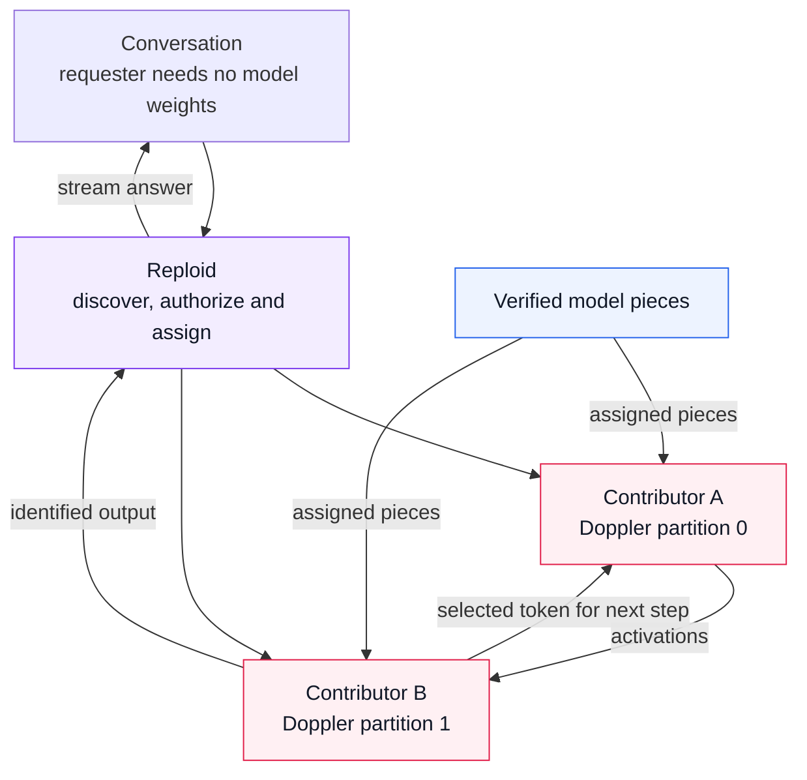
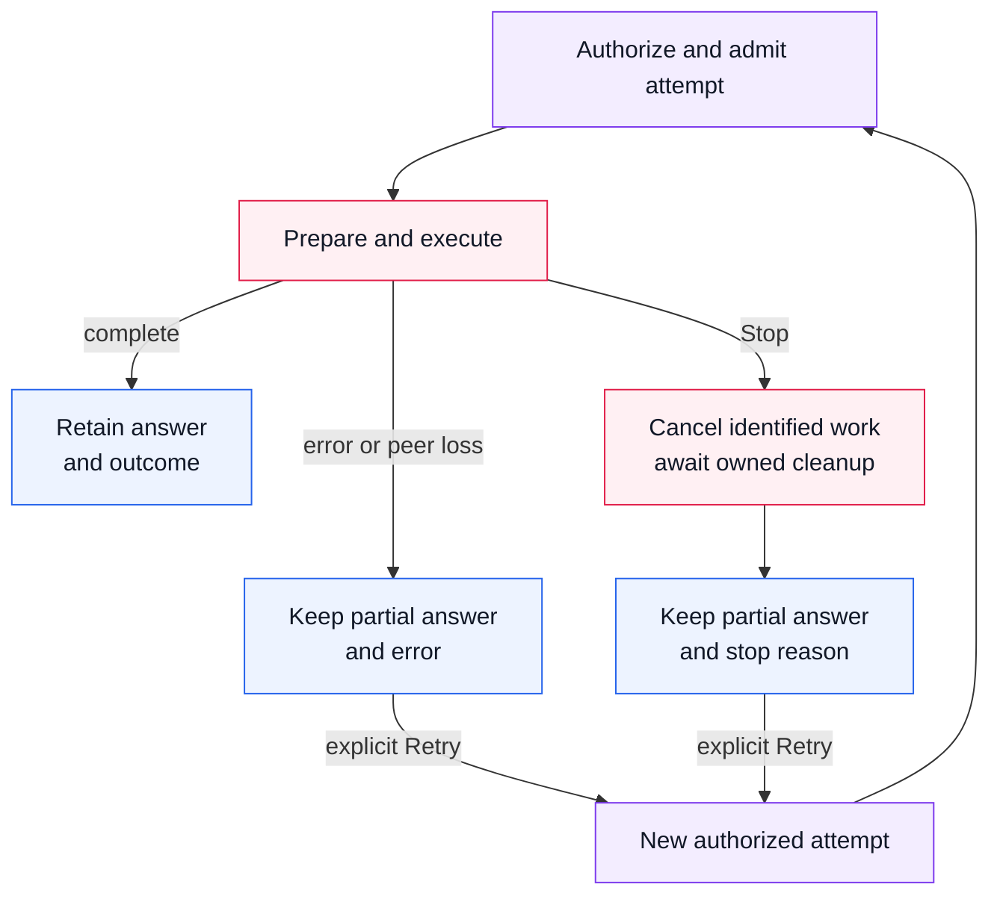

# Reploid

A network where people and agents combine models, tools, storage, and compute.
Chat is the first interface; each participant controls contribution and disclosure.

**[Try Reploid](https://replo.id/)** · [Get started](docs/QUICK-START.md) · [Documentation](docs/INDEX.md)

## Get started

From a repository checkout, install and start the browser application:

```sh
npm install
npm start
```

Open `http://localhost:8000`. Choose an available model, ask a question, and review
recipients before sharing inputs. A prepared peer can execute without requester
weight downloads. Local execution separately requires WebGPU and model files.

Conversations remain independent. After interruption, keep the partial answer
and explicitly retry. Storage and compute contribution are optional, with their
own permissions and limits. See the [conversation contract](docs/chat-mvp.md).

## Technical architecture

### Component ownership

Reploid coordinates; Doppler computes; Poolday transport connects participants.
This diagram shows the two-partition path, not a deployment qualification.



Storage sharing, whole requests, model partitions, and agent subtasks retain
distinct contracts. Introduction or transport access grants no compute or
input-disclosure permission.

### Attempt failure and recovery

Every attempt has its own identity, output, and cancellation boundary.



A lost connection does not prove GPU cleanup. Restart creates a new attempt;
saved outcomes do not restore model execution state. Other conversations keep
their own progress and histories.

## Evidence

Partition execution is implemented; complete numerical and application
qualification remains open. The [surface claim index](docs/status/surface-claim-index.json)
records supported scopes and unresolved gates. Cross-host rendezvous still
requires signaling; a receipt alone does not prove honest execution.

Improvement is a separate workflow: independently evaluate changes, authorize
reversible adoption, then measure results. Model confidence never grants authority.
See [improvement episodes](docs/rsi-improvement-episodes.md).

## Read next

- [Architecture](docs/open-mesh-architecture.md) — coordination, custody, and recovery.
- [Security](docs/SECURITY.md) — permission and trust boundaries.
- [Zero and X](docs/zero-x-quick-start.md) — optional agent configurations.
- [Goals](GOALS.md) · [Contributing](AGENTS.md) — priorities and component ownership.

## License

[MIT](LICENSE).
