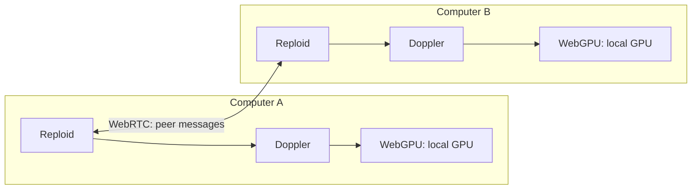
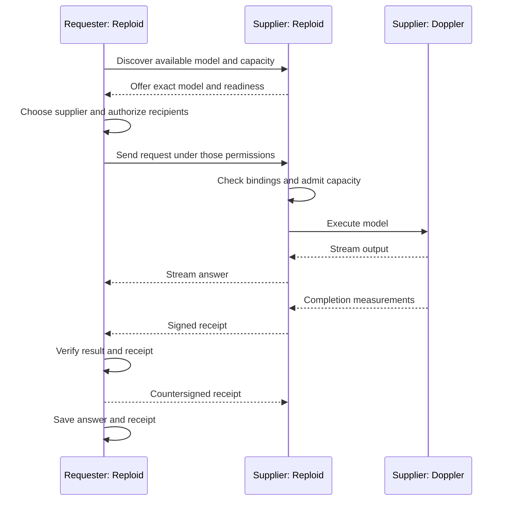
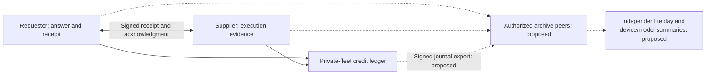

# Reploid: concepts and code

Reploid coordinates work across computers. Doppler runs models on each executing
computer. WebRTC carries peer messages; WebGPU submits local GPU work.

Read these three views in order: [overview](#1-overview),
[one request](#2-one-request), [record keeping](#3-record-keeping).

## 1. Overview

| Name | Plain job | Where it lives |
| --- | --- | --- |
| Reploid product | The interface for asking, contributing and inspecting computers | [`apps/poolday/`](../apps/poolday) |
| Reploid library | Conversations, discovery, placement, permissions and work records | [`packages/reploid/src/`](../packages/reploid/src) |
| Doppler | Load the exact model and execute its computations | [Doppler repository](https://github.com/clocksmith/doppler) |
| WebRTC | Peer connections and data channels | Platform API, used by Reploid's [`transport/`](../packages/reploid/src/transport) |
| WebGPU | GPU commands, buffers and compute execution | Platform API, used by Doppler |

Only executing computers need a model runtime. A requester can use a prepared
remote model without downloading its weights. WebRTC does not join the GPUs into
shared memory. Signaling and service APIs also use HTTP/WebSocket paths, so
Reploid's responsibility extends beyond WebRTC calls.

**Poolday** is the internal name retained in product folders and some older peer
infrastructure. The site calls the product Reploid. **Zero** and **X** name the
separate agent workspaces in `self/`.

## 2. One request

This shows a completed whole-model request with a signed receipt. Each retry is
a new attempt. Split-model execution has its own
[technical sequence](open-mesh-architecture.md#preparation-and-the-generation-loop).

Owners: [chat execution](../apps/poolday/host/chat-execution.js),
[peer execution and receipt exchange](../packages/reploid/src/mesh/peer-generation.js),
[saved conversations](../apps/poolday/host/chat-session.js),
[Doppler runtime bridge](../shared/infrastructure/doppler-runtime-service.js).
This is the successful path; interruption retains partial output and unresolved
cleanup or settlement stays visible. It does not promise persistence before
acknowledgment; that ordering is part of the record-keeping proposal below.

## 3. Record keeping

Solid arrows show existing code paths, not deployment qualification. Dashed
arrows and nodes marked proposed describe the [mesh record-keeping design](mesh-records.md).
Archive transfers would carry authorized, encrypted evidence.
The credit path applies to an enrolled private fleet; exchanging public usage
receipts does not automatically create credits or debt.

Owners: [signed receipt primitives](../packages/reploid/src/artifacts/receipt.js),
[native recovery journal](../server/native-generation-journal.js),
[credit evidence verification](../server/fleet/credit-evidence.js),
[credit admission and settlement](../server/fleet/credits.js).
Peer replication and independently replayed summaries remain proposed. The
current [browser counters](../apps/poolday/host/contribution-history.js) summarize
retained local records; they are not a mesh-wide audited total.

## Terms used in code

| Term | Meaning |
| --- | --- |
| Computer | A physical device. A name or signing key alone does not prove unique hardware. |
| Participant | A software instance using an identity on the network. One computer can run several. |
| Host | The browser or native process supplying policy, credentials, storage and runtime access to the library. |
| Requester / supplier | Roles: request work / offer capacity or files. A computer can do both. |
| Mesh | The participating network, with each peer's observed connections and offers. |
| Model / artifact | A model name identifies a model; an artifact identity pins the deployed weights and associated configuration. Different quantizations are different artifacts. |
| Resident | A prepared model or model partition held by a runtime for reuse. |
| Replica | Another complete copy serving independent requests. |
| Partition | A complementary portion of one model computation, executed as part of a complete route. |
| Piece | A verified chunk of stored model data. Owning pieces does not establish executable capacity. |
| Attempt | One identified execution of a request. A retry creates a new attempt. |
| Receipt | Signed evidence bound to identified work. What it establishes depends on its schema, signatures and acknowledgments. |
| Supplied / consumed tokens | Recorded output produced / used, with the stated model, period and evidence coverage. |
| Service credits | Accounted exchange balances, including policy-bounded debt in the private fleet. Token counters alone do not issue credits. |

Use **pieces** for stored bytes, **partitions** for split computation, and
**replicas** for complete copies. The word "sharding" needs one of those meanings
specified. Serialized `Pack`, `AdapterPack` and `Capsule` names retain their own
versioned contracts; a loaded model is not automatically a qualified signed Capsule.
Detailed [earning vocabulary](open-mesh-architecture.md#earning-vocabulary) remains
defined with its owning contracts.

## Where to make a change

| Job | Start here |
| --- | --- |
| Product interface | [`apps/poolday/ui/pool-home/`](../apps/poolday/ui/pool-home) |
| Compose the browser application | [`product-session.js`](../apps/poolday/host/product-session.js) |
| Conversation lifecycle and execution routing | [`chat-session.js`](../apps/poolday/host/chat-session.js), [`chat-execution.js`](../apps/poolday/host/chat-execution.js), reusable [`chat/`](../packages/reploid/src/chat) |
| Peer discovery and execution coordination | [`mesh/`](../packages/reploid/src/mesh), browser host [`work-swarm.js`](../apps/poolday/host/work-swarm.js) |
| Peer connections and delivery | [`transport/`](../packages/reploid/src/transport) |
| Connect Reploid to Doppler | [`doppler-runtime-service.js`](../shared/infrastructure/doppler-runtime-service.js), product [`providers/`](../apps/poolday/providers) |
| Native participation and private-fleet accounting | [`native-participant.js`](../server/native-participant.js), [`server/fleet/`](../server/fleet) |
| Model arithmetic and GPU kernels | [Doppler source](https://github.com/clocksmith/doppler/tree/main/src) |
| Zero/X agent substrate | [`self/`](../self), [agent architecture](system-architecture.md) |

The product lives in `apps/poolday/`; the reusable library lives in
`packages/reploid/`. `shared/vendor/` contains generated dependency copies, not an
additional implementation to edit. Hosted paths such as `/host/` and `/pool/`
can map to product files through the [served-tree ownership map](ownership-inventory.md).
Read the source owner's nearest `AGENTS.md` and CATSCAN before editing.

For complete execution flows, use the [architecture diagrams](open-mesh-architecture.md#technical-diagrams).
For proposed receipt replication, use [mesh record keeping](mesh-records.md);
that design is not a statement that replication is deployed.
